# First-time setup guide (macOS) — desktop app

فارسی: [راهنمای نصب اولیه](FIRST_TIME_FA.md)

This guide is for installing from the **DMG** and using the **graphical app** (no Terminal required).  
If you prefer installing from source as a developer, see the optional appendix at the end.

---

## Internet and VPN (important)

In Iran these two networks get mixed up often. Simple rule:

| Task | Network you need |
|---|---|
| Installing the app, reaching **Gmail / Google Cloud**, cloning from GitHub | A **personal VPN** that bypasses sanctions |
| Logging into **company email / Outlook / Exchange**, listing work events | **Company VPN** or company Wi‑Fi (turn the personal VPN **off**) |

You usually cannot use one VPN for both. Switch between them.

---

## 1) Install from the DMG

1. Get the latest build from the GitHub Releases page:  
   [Latest release](https://github.com/hamidhandid/outlook-to-gmail-calendar-syncer/releases/latest)  
   Download the **`.dmg`** file (e.g. `Outlook-to-Google-Calendar-Syncer-….dmg`) and open it.
2. Drag **Outlook to Google Calendar Syncer** into **Applications**.
3. Open the app from Applications (double-click).

### First launch blocked by macOS?

If the app is not yet signed/notarized with an Apple Developer ID, macOS may refuse to open it.

1. Go to **System Settings → Privacy & Security**.
2. Near the bottom you should see a message like “Outlook to Google Calendar Syncer was blocked…”.
3. Click **Open Anyway** and confirm.

Then open the app from Applications again.

### Mac password and Always Allow

Whenever the app starts (or when it saves your Outlook password), macOS may ask for **Keychain** access and your Mac login password.

- Enter your Mac password.
- If you see **Always Allow**, choose that so it does not ask every time.

App data lives here:

`~/Library/Application Support/outlook-to-gmail-calendar-syncer/`

(**Open data folder** in the app opens the same path.)

---

## 2) Quick tour of the window

**Left — config and Outlook**

- `days_back` / `days_forward` — how many days of past/future events (defaults 7 and 60)
- `email` — work email
- **Login to Outlook** / **Check Outlook auth**
- `server` — default `mail.digikala.com`
- `username` — leave empty (same as email) unless IT says otherwise
- `auth` — usually `ntlm`
- **verify SSL** — usually leave **unchecked**
- **Save config** — writes settings

**Right — Google**

- Google calendar name (default `Work (Outlook)`)
- **Setup Google** — wizard to create the Cloud project and `credentials.json`
- **Sign in to Google** / **Reauth Google** / **Check Google auth**
- `privacy` — default `full` (titles and details). Use `busy` for Busy-only blocks

**Bottom**

- **Show events from outlook** — list Exchange events
- **Sync** — copy those events to Google (enabled after a successful Get)
- **Sync dry-run** — preview only, no Google writes
- **Every** + **Install schedule** — automatic runs (for example every 30 minutes)

---

## 3) First: log in to Outlook

For this section turn the **company VPN on** and the personal VPN **off**.

1. In **email**, type your work address, e.g. `you@digikala.com` or `you@fidibo.com`  
   (not `@mail.digikala.com` — that is the server host, not your mailbox).
2. Confirm **server** is correct (often `mail.digikala.com`).
3. Click **Save config**.
4. Click **Login to Outlook** and enter your work email password.
5. If macOS asks about Keychain: Mac password + **Always Allow** if offered.
6. Click **Check Outlook auth** to confirm success.

If login fails:

- Are you still on company VPN / Wi‑Fi?
- Leave `username` empty; if needed try `COMPANY\account`.
- Switch `auth` between `ntlm` and `basic`, then Save + Login again.

---

## 4) Next: Setup Google (screenshot for each step)

For this section turn your **personal (anti-sanctions) VPN on**.

Click **Setup Google**. The app opens the browser step by step and shows a guide screenshot for each action. After you finish the browser work, click **Confirm** in the app to continue. If you quit midway, click **Setup Google** again — it resumes where you left off.

Screenshots use `example@gmail.com`; use your real Gmail.

### Step 1 — Create a Google Cloud project

Pick a project name (e.g. `outlook-calendar-sync`) and click **Create**. At the top of the page, make sure that project is selected.

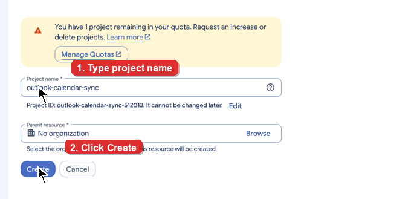

### Step 2 — Enable the Google Calendar API

Click **Enable**. When it finishes, return to the app and Confirm.

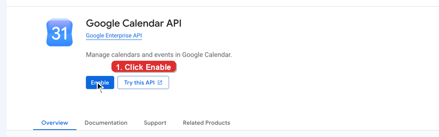

### Step 3 — OAuth / Google Auth Platform

#### 3‑1) Get started

If you see “Google Auth Platform not configured yet”, click **Get started**.

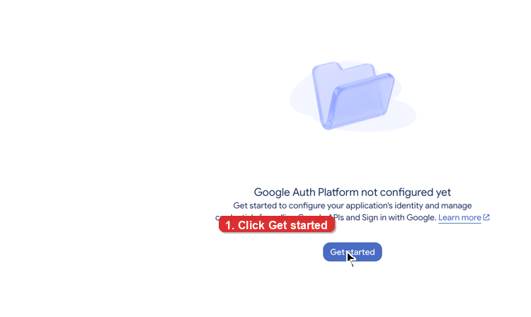

#### 3‑2) App name and User support email

1. App name e.g. `Outlook Calendar Sync`
2. User support email: your Gmail
3. **Next**

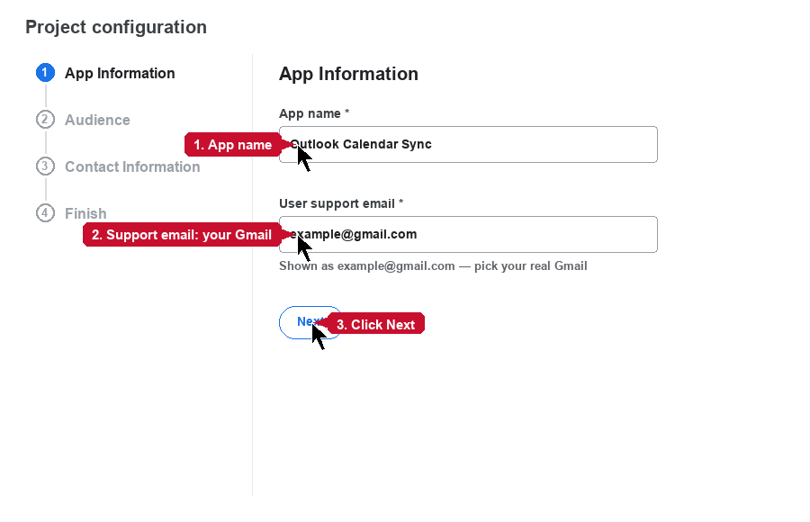

#### 3‑3) Audience = External

For a personal Gmail choose **External** (Internal is only for company Workspace), then **Next**.

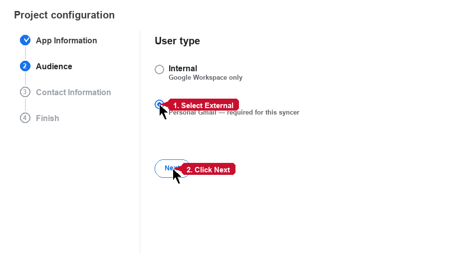

#### 3‑4) Contact Information

Enter your email again and click **Next**.

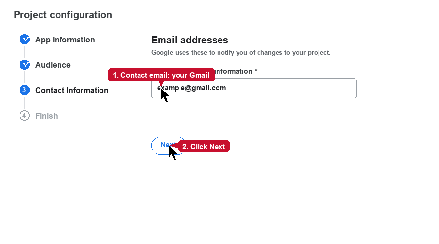

#### 3‑5) Finish

Check **I agree…**, click **Continue** if shown, then **Create**.

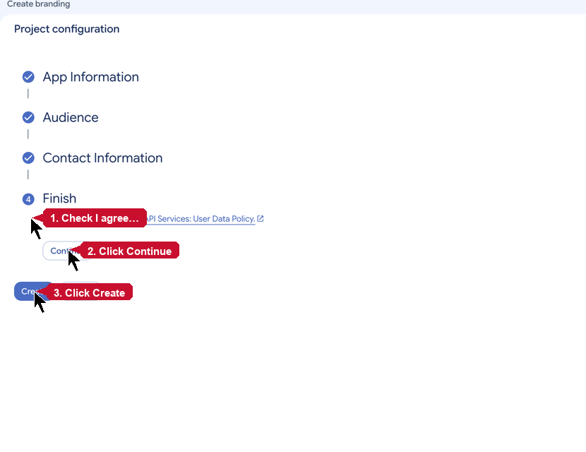

### Step 4 — Add yourself as a test user

Click **+ Add users**:

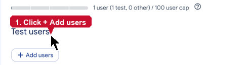

Type your full Gmail, press Enter (so it becomes a chip), then **Save**:

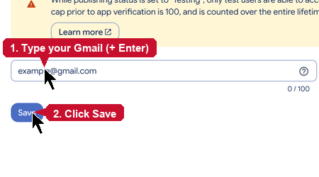

### Step 5 — Create a Desktop client and download JSON

1) Click **Create client**:

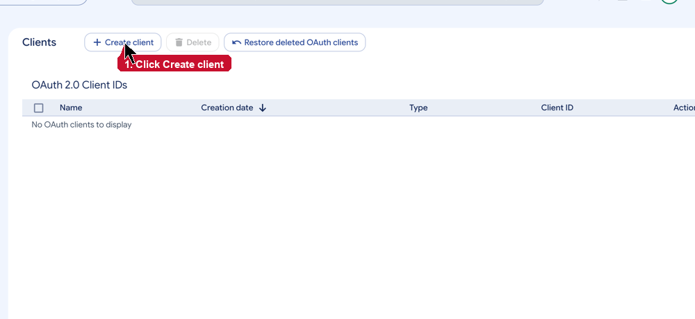

2) Application type: **Desktop app** (not Web, not iOS). Name e.g. `Mac syncer`, then **Create**:

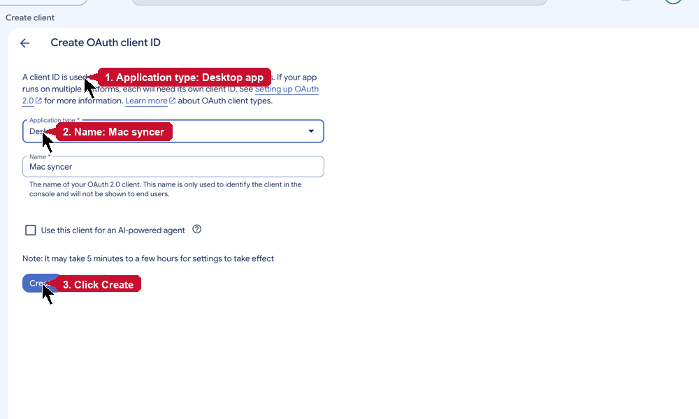

3) In the popup click **Download JSON**:

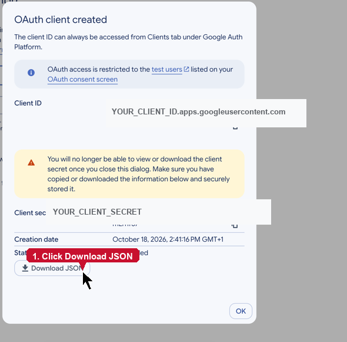

### Step 6 — Save as credentials.json

The downloaded file must end up in the app data folder as **`credentials.json`**. The wizard usually offers to copy it from Downloads — Confirm. Or use **Import credentials** and pick that JSON.

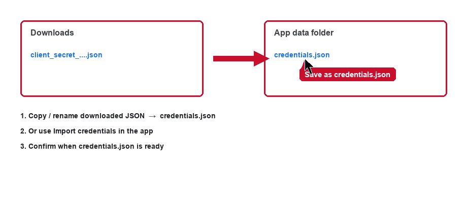

### Sign in to Gmail (token.json)

After Setup, if you see **Sign in to Google**, click it (personal VPN still on). In the browser pick your Gmail and Continue.

If Google says the app is unverified: **Advanced → Go to … (unsafe)** — normal for personal use.

While the Cloud app stays in **Testing**, Google may expire the login after about **7 days** — click **Reauth Google** when that happens.

Use **Check Google auth** to verify everything is ready.

---

## 5) Fetch events and sync

Once **both Outlook and Google** are set up:

### Show Outlook events

1. Turn the **company VPN** on.
2. Click **Show events from outlook**.
3. Events should appear in the Outlook events pane. If not, re-check Outlook login and company VPN.

### Copy to Google Calendar

1. If the company network blocks Google, turn the **personal VPN** on.
2. Click **Sync** (enabled after a successful Show events).
3. Events appear under the Google calendar name you chose (default **Work (Outlook)**). The app also sets a default **15-minute** popup reminder on that calendar.

Use **Sync dry-run** first if you only want a preview.

### Company mail now, Google later

1. On company VPN: **Get from outlook and Store encrypted** — asks for a separate password for the encrypted file.
2. Later, when Google is reachable: **Sync from encrypted file** — same password, no second Outlook fetch.

---

## 6) Automatic sync (e.g. every 30 minutes)

To have the Mac repeat this for you:

1. In the Schedule row, set **Every** to **`30m`** (or `15m` / `1h` / `3h` / `6h` / `12h`).
2. Click **Install schedule**.
3. macOS uses **launchd**. If a background run fails, you may get a Notification Center alert.

To stop: **Uninstall schedule**.

Note: for automatic sync to succeed, at run time your Mac still needs to reach the company mail server (company VPN/Wi‑Fi) and, when required, Google — depending on your network.

---

## Quick checklist

- [ ] DMG installed; **Open Anyway** in Privacy & Security if needed  
- [ ] Keychain prompt: Mac password + **Always Allow** when offered  
- [ ] On company VPN: **Login to Outlook** succeeded  
- [ ] On personal VPN: **Setup Google** + **Sign in to Google** succeeded  
- [ ] **Show events from outlook** listed events  
- [ ] **Sync** copied them to Google  
- [ ] Optional: **Every → 30m → Install schedule**

Good luck!

---

## Optional appendix: install from Terminal (developers)

If you are not using the DMG:

1. Turn on a personal VPN; install Homebrew and Python 3.11.
2. Clone the repo, create a venv, `pip install -r requirements.txt`.
3. Run `python -m syncer gui` and follow the GUI sections above  
   **or** `python -m syncer setup` for the text wizard in Terminal.

For most people the recommended path is **DMG + the desktop app**.
